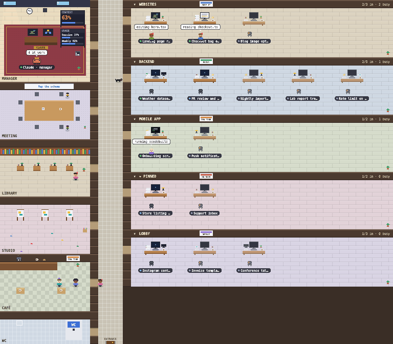
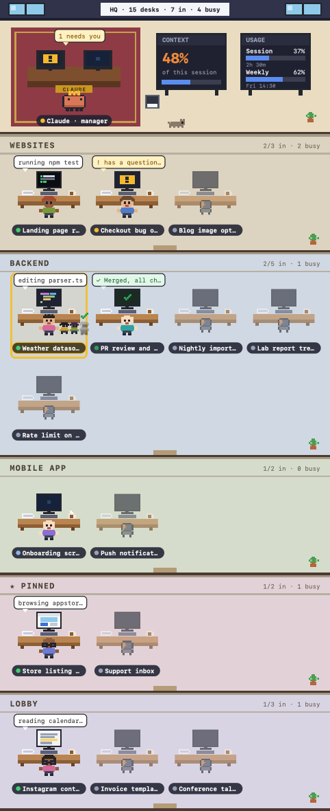

# Pixel HQ

**Your Claude Code sessions, as a pixel-art office.** Every chat in your sidebar gets a desk, every sidebar group gets a room, and Claude is the manager in the corner office. People walk to the library to browse the web, to the studio to make images, to the café when they have nothing to do; subagents work at the meeting table and bring their results back to the desk. Confetti when a turn finishes. There is a black labrador.



One command runs it on your machine; your phone opens it over the same Wi-Fi. Nothing about your sessions leaves your computer.

## Highlights

- **A desk per session, a room per sidebar group.** The office is your sidebar: custom groups in their order, then PINNED and a LOBBY for the rest. Fold a room you rarely look at from its header.
- **People go where the work is.** At the desk for code and terminals (the screen shows what runs), in the **library** for the web, in the **studio** for images and pages, at the **café** after a while idle (chatting, sipping, scrolling), off to the **WC** now and then. New sessions walk in through the entrance; closed ones walk out and leave a coat on the chair.
- **Subagents are real people.** They sit at the meeting table while they run, the projector shows what they are on, and when they finish they carry their paper to their session's desk, hand it over and leave.
- **The manager keeps score.** Claude's corner office has the CONTEXT board and the USAGE board, which shows your plan's limits as the app's usage card does, the per-model weekly one (such as Fable) included, and when a spent one comes back. A bin fills with context, a clock runs on real time, and a red lamp blinks when a limit is nearly spent. Once one is spent, the lamp flashes and washes the corner office in red.
- **Things happen.** Confetti when a turn finishes, smoke when it fails, a party at the café when a pull request merges, a `!` bounce when a session needs your answer, a ticker of the latest tool calls of every session under the office.
- **When Claude is down, the office panics.** While Anthropic's status page reports an outage or a major incident on Claude Code or the API, or your sessions keep dying on overloaded and server errors, an alarm goes off. The whole office flashes red under sirens, a banner names the incident, and everyone drops what they are doing and runs around shouting; in calm mode they stay at their desks and shake. The manager says to stay calm. The dog does not. Add `?outage` to the address for a fire drill.
- **A place, not a chart.** Plank, checker, tile and carpet floors, posters, reading lamps, an espresso machine with steam, two things on every desk picked by the session, papers that pile up, lamps and screens that glow at night, and a dog that wanders.
- **Calm or lively**, your pick: calm keeps everyone at their desk, like a status board; lively lets the office live.
- **Click anyone** for the session: what it is doing, its subagents, its last twenty tool calls, and a button that opens it in Claude.
- **Private by design.** A Claude Code plugin (the mod) writes what each session does to a file on your disk; the app reads that file. No account, no server, no telemetry. The mirror on your phone is your own Wi-Fi, and the one request out is a read of Anthropic's public status page once a minute, which `--no-status` turns off.

## Get it, in two steps

### 1. Install the mod

At the prompt of a terminal session:

```
/plugin install pixel-hq --marketplace boz1997/pixel-hq
```

Answer `y` to add the marketplace, then pick a scope (user is first).

From a shell:

```
claude plugin install pixel-hq --marketplace boz1997/pixel-hq
```

In the desktop app, where `/plugin` does not run: click + next to the prompt box, then Plugins, Add marketplace with `boz1997/pixel-hq`, then Add plugin.

Every session that should have a desk needs the mod loaded, so install it at the user scope and restart the sessions that were already open. The mod opens nothing by itself: it only publishes. `/hq` in a session opens a still picture of the office in a pane beside that chat, for a look without leaving it.

### 2. Run the office

```
npx github:boz1997/pixel-hq
```

(or `node bin/pixel-hq.js` in a clone). It starts at http://localhost:2323, opens the office in a window of its own, and prints the address your phone can open on the same Wi-Fi, such as `http://your-mac.local:2323`. Keep it running; the page updates itself every two seconds.

- `--port 5000` picks another port (a taken one is skipped for the next), `--browser` opens a plain tab instead of a window, `--no-open` opens nothing.
- `--password secret` asks for the password before showing the office; without one, anyone on your network who finds the port can look. `--local-only` listens on this computer alone.
- `--demo` shows a made-up office, so you can see the app before installing the mod.
- `--no-status` stops the app asking status.claude.com whether Claude is down; the office then panics only on your sessions' own errors.



## How it knows

The mod is a Claude Code plugin of function hooks: it hears each session's tool calls, turns, subagents, permission dialogs and rate-limit readings, and publishes a small record of that session (its state, its current tool, its subagents, its last twenty calls) to `~/.claude/plugins/store/`. It also publishes what the desktop app says about the sidebar (the groups and the sessions in them) and about your plan's limits (its usage card, read once a minute by one session for all), and the kind of API error a turn died on. The app adds what status.claude.com says of Claude Code and the API. The app merges those records and draws the office; everything that moves, from the walking to the café chats, is decided in the browser.

## Develop

- `hooks/`, `types/` and `.claude-plugin/` are the mod. `claude plugin validate <folder>` checks it; `tsc -p <folder>` type-checks it once a session has loaded it and laid `.claude-plugin/types/` beside it (TypeScript 5.4 or newer). To run the mod from its folder in every session, name the folder in `CLAUDE_CODE_PLUGIN_DIRS` in the `env` block of `~/.claude/settings.json`; `CLAUDE_CODE_PLUGIN_DIR_WATCH=1` reloads it when a file changes.
- `app/` is the office app: `server.js` reads the mod's store files and serves `public/`, where `office.js` is the whole scene (layout, walking, behaviour, drawing) and `sprites.js` the pixel art; `demo.js` is the made-up office. No build step, no dependencies.
- `CHANGELOG.md` says what each version brought.

## Notes

- Claude's orange mascot belongs to Anthropic; the people, furniture and rooms are original pixel art.
- The mod reads only what the desktop app tells it about your sessions and what each session's own copy publishes. The app reads that from your disk and serves it on your own network. Nothing is sent anywhere else; the app's only request out reads Anthropic's public status page and carries nothing of yours.
- MIT licensed. Made by Berk Özdoruk ([Boz Apps](https://bozapps.net)) with Claude Code.
