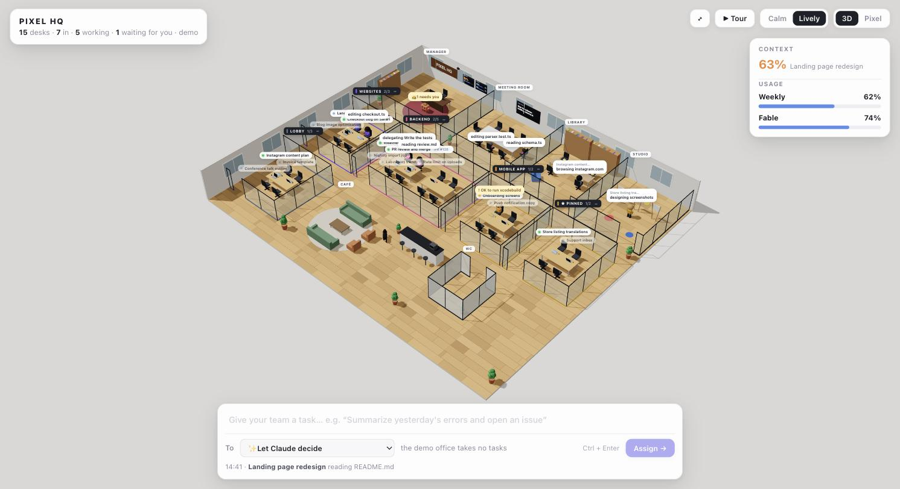
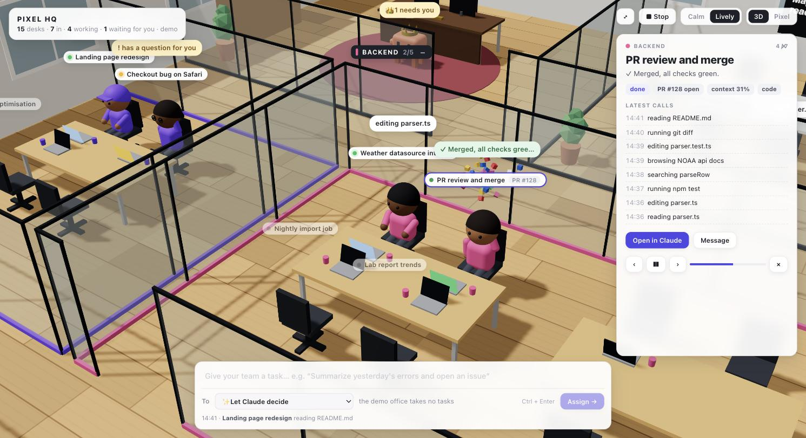
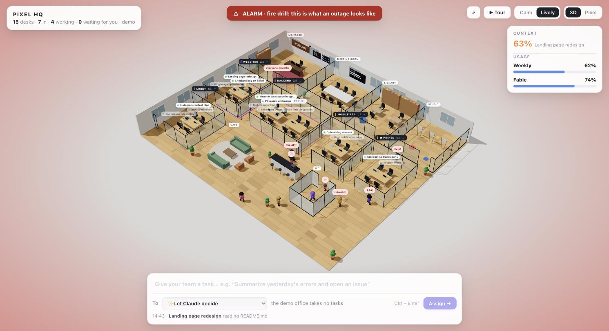

# Pixel HQ

**Your Claude Code sessions, as an office you can walk through.** Every chat in your sidebar gets a desk, every sidebar group gets a glass room, and Claude runs the place from the corner office. People sit and type while their session works, take a coffee break when it is idle, browse in the library and paint in the studio; subagents meet in the meeting room and carry their results back. Give the team a task from the office itself, take the guided tour, and watch the whole floor panic when Claude is down. There is a black labrador.



One command runs it on your machine; your phone opens it over the same Wi-Fi. Nothing about your sessions leaves your computer.

## Highlights

- **A 3D office of your sidebar.** Your custom groups become glass rooms in their sidebar order, then PINNED and a LOBBY for the rest. Every session has a desk with its name, its model or its pull request, and a laptop that lights up by what it does. Fold a room you rarely look at from its label.
- **People do what their sessions do.** They type at their desk while the session works, go to the **library** while it browses the web and to the **studio** while it makes images or pages, wave when it needs your answer, and take a break at the **café** or the **WC** now and then when it is idle. New sessions walk in through the entrance; closed ones walk out.
- **Results you can see.** When a turn finishes, the files it wrote land on the desk as a little slip (`📄 report.md`) and in a "Done ✓" bubble, with confetti; the session's card keeps the gist of the answer.
- **Give your team a task.** Type it in the bar at the bottom, pick a session or let Claude decide, and the task lands in that session's chat. The card of any session has a Message button for the same.
- **A guided tour.** ▶ Tour flies the camera from desk to desk with a card for each session: what it is doing, its model, its last result, its subagents, its latest calls, and buttons to open it in Claude or message it.
- **The manager keeps score.** Claude's corner office has the CONTEXT board and the USAGE board, which shows your plan's limits as the app's usage card does, the per-model weekly one (such as Fable) included, and when a spent one comes back. A red lamp blinks when a limit is nearly spent; once one is spent, it flashes and washes the corner office in red.
- **When Claude is down, the office panics.** While Anthropic's status page reports an outage or a major incident on Claude Code or the API, or your sessions keep dying on overloaded and server errors, the whole office flashes red, a banner names the incident, and everyone drops what they are doing and runs around shouting; in calm mode they stay at their desks and shake. The manager says to stay calm. The dog does not. Once Anthropic is monitoring a fix, the alarm drops to a yellow banner, and it clears when the incident is resolved. Add `?outage` to the address for a fire drill.
- **Calm or lively**, your pick: calm keeps everyone at their desk, like a status board; lively lets the office live.
- **Still pixel at heart.** The original pixel-art office is one click away: Pixel in the top right, or `/pixel.html`.
- **Private by design.** A Claude Code plugin (the mod) writes what each session does to a file on your disk; the app reads that file. No account, no server, no telemetry. The mirror on your phone is your own Wi-Fi, and the one request out is a read of Anthropic's public status page once a minute, which `--no-status` turns off.



## Get it, in two steps

### 1. Install the mod

At the prompt of a terminal session:

```
/plugin install pixel-hq --marketplace boz1997/pixel-hq
```

Answer `y` to add the marketplace, then pick a scope (user is first).

From a shell:

```
claude plugin install pixel-hq --marketplace boz1997/pixel-hq
```

In the desktop app, where `/plugin` does not run: click + next to the prompt box, then Plugins, Add marketplace with `boz1997/pixel-hq`, then Add plugin.

Every session that should have a desk needs the mod loaded, so install it at the user scope and restart the sessions that were already open. The mod opens nothing by itself: it only publishes. `/hq` in a session opens a still picture of the office in a pane beside that chat, for a look without leaving it.

### 2. Run the office

```
npx github:boz1997/pixel-hq
```

(or `node bin/pixel-hq.js` in a clone). It starts at http://localhost:2323, opens the office in a window of its own, and prints the address your phone can open on the same Wi-Fi, such as `http://your-mac.local:2323`. Keep it running; the page updates itself every two seconds. Drag to turn the office, scroll to zoom, click anyone for their card.

- `--port 5000` picks another port (a taken one is skipped for the next), `--browser` opens a plain tab instead of a window, `--no-open` opens nothing.
- `--password secret` asks for the password before showing the office; without one, anyone on your network who finds the port can look. `--local-only` listens on this computer alone.
- `--demo` shows a made-up office, so you can see the app before installing the mod.
- `--no-status` stops the app asking status.claude.com whether Claude is down; the office then panics only on your sessions' own errors.

## Tasks, and what they can do

- A task goes out only from the computer that runs the app, or from another device that knows the `--password`. The server checks where each request comes from, so a page of another site open in your browser cannot send one.
- The app drops the task in `~/.pixel-hq/inbox`; the mod of the session it is for takes it into its own chat, and a session that does not run the mod gets it as a message from another session.
- A session runs a task like anything you type into it, in its own permission mode: a session that skips permission prompts acts on it without asking. Send what you would type yourself.
- "Let Claude decide" asks Claude Haiku once, with your sessions' titles, which one fits the task.



## How it knows

The mod is a Claude Code plugin of function hooks: it hears each session's tool calls, turns, subagents, permission dialogs and rate-limit readings, and publishes a small record of that session (its state, its current tool, its model, the files its last turn wrote, its subagents, its last twenty calls) to `~/.claude/plugins/store/`. It also publishes what the desktop app says about the sidebar (the groups and the sessions in them) and about your plan's limits (its usage card, read once a minute by one session for all), and the kind of API error a turn died on. The app merges those records, adds what status.claude.com says of Claude Code and the API, and draws the office; everything that moves, from the walking to the coffee breaks, is decided in the browser.

## The pixel office

The first Pixel HQ, a pixel-art office on a canvas, still lives at `/pixel.html`, with everything above but the tour and the task bar.


## Develop

- `hooks/`, `types/` and `.claude-plugin/` are the mod. `claude plugin validate <folder>` checks it; `tsc -p <folder>` type-checks it once a session has loaded it and laid `.claude-plugin/types/` beside it (TypeScript 5.4 or newer). To run the mod from its folder in every session, name the folder in `CLAUDE_CODE_PLUGIN_DIRS` in the `env` block of `~/.claude/settings.json`; `CLAUDE_CODE_PLUGIN_DIR_WATCH=1` reloads it when a file changes.
- `app/` is the office app: `server.js` reads the mod's store files, watches the status page, takes tasks and serves `public/`. `public/hq/` is the 3D office: `plan.js` lays out the floor and its walking grid, `world.js` builds the scene, `people.js` the people, `sim.js` moves them, `ui.js` draws the labels, the cards, the tour and the task bar, `main.js` ties them together. `public/office.js` and `sprites.js` are the pixel office; `demo.js` is the made-up office. No build step and no dependencies: three.js r170 is vendored under `public/vendor/three` with its MIT license.
- `CHANGELOG.md` says what each version brought.

## Notes

- Claude's orange mascot belongs to Anthropic; the people, furniture and rooms are original.
- The mod reads only what the desktop app tells it about your sessions and what each session's own copy publishes. The app reads that from your disk and serves it on your own network. Nothing is sent anywhere else; the app's only request out reads Anthropic's public status page and carries nothing of yours.
- MIT licensed. Made by Berk Özdoruk ([Boz Apps](https://bozapps.net)) with Claude Code.
